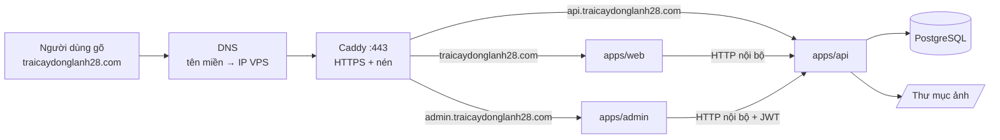
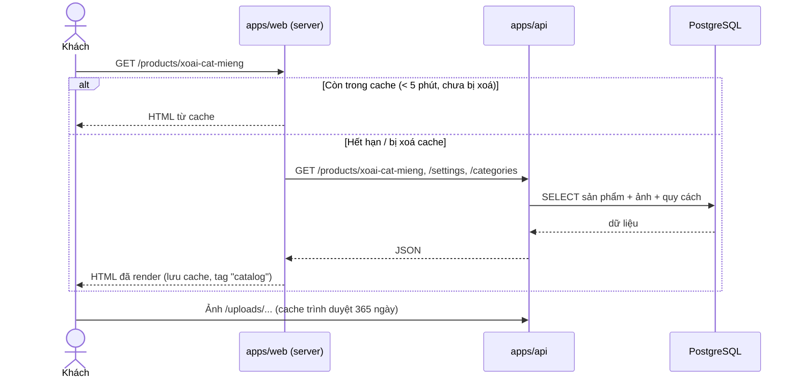
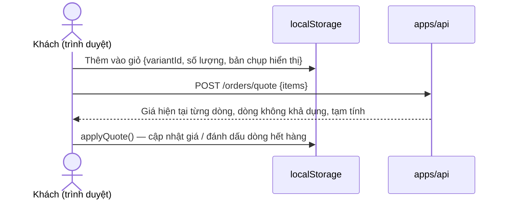
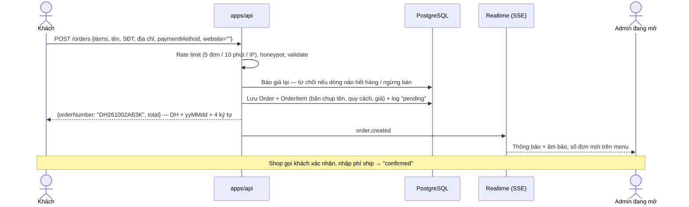
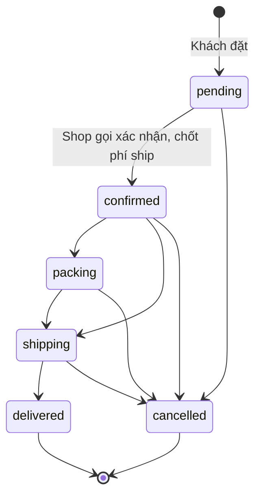
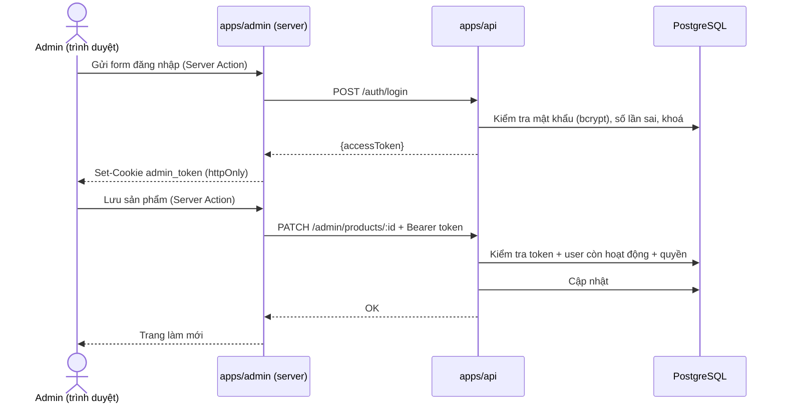
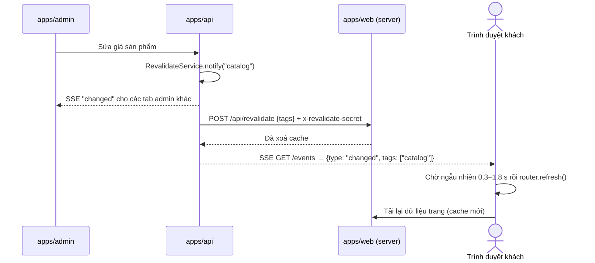

# Luồng hoạt động

Tài liệu này trả lời: **một thao tác của người dùng đi qua những thành phần nào, theo thứ tự nào.** Sơ đồ dùng Mermaid (GitHub tự vẽ).

## 0. Từ địa chỉ web đến màn hình

Mọi luồng bên dưới đều bắt đầu bằng chặng đường chung này:

*(`traicaydonglanh28.com` là ví dụ — thay bằng `<DOMAIN>` thật.)*

Rút gọn: **Người dùng → Domain → DNS → Caddy → Frontend → API → Backend → Database → JSON → Frontend → Người dùng.**

Hai kiểu gọi API cần phân biệt:

| Kiểu | Đi từ | Dùng cho | Vì sao |
|---|---|---|---|
| **Server → API** (mạng nội bộ Docker `http://api:4000`) | Server `apps/web`, server `apps/admin` | Đọc dữ liệu render trang; mọi thao tác admin | Nhanh, cache được, token admin không lộ ra trình duyệt |
| **Trình duyệt → API** (`https://api.<DOMAIN>`) | Trình duyệt khách | Báo giá, đặt hàng, tra cứu, liên hệ, SSE | API thấy **IP thật của khách** để giới hạn tần suất |

---

## 1. Khách xem sản phẩm

- `src/lib/api.ts` (web) gọi `fetch` với `next: { revalidate: 300, tags }`. Tag: `catalog` (sản phẩm, danh mục), `content` (bài viết, banner, chính sách), `settings`.
- API lỗi → web dùng dữ liệu dự phòng (thông tin cửa hàng mặc định, danh sách rỗng); trang không sập.

## 2. Giỏ hàng và báo giá

Giỏ hàng chỉ nằm trên trình duyệt (khoá `traicay28:cart:v2`). Giá trong giỏ chỉ để hiển thị; API luôn tính lại.

## 3. Đặt hàng

Sau khi đặt, khách tra cứu bằng `GET /orders/lookup?orderNumber=&phone=` (phải khớp cả hai).

### Vòng đời đơn hàng

Trạng thái chỉ đi tiến; `delivered` và `cancelled` là trạng thái cuối. Mỗi lần đổi ghi một dòng `order_status_logs` (ai, lúc nào, ghi chú). Trạng thái thanh toán (`unpaid / paid / refunded`) độc lập với trạng thái đơn. Doanh thu không tính đơn huỷ.

## 4. Chủ shop / nhân viên quản lý

- Trình duyệt **không bao giờ** thấy token; mọi lệnh gọi API đi từ server admin.
- API trả 401 → admin chuyển tới `/logout?expired=1` → về `/login`.

### Tải ảnh

Admin chọn file → Server Action `uploadImageAction` → `POST /admin/uploads` → API kiểm tra chữ ký file (magic bytes), ≤ 5 MB → lưu `uploads/yyyy/mm/<ngẫu nhiên>.<ext>` → trả URL. Database chỉ lưu đường dẫn tương đối `/uploads/...`.

## 5. Cập nhật realtime

Khi admin sửa dữ liệu, web khách đang mở tự cập nhật mà không mất giỏ hàng:

| Luồng SSE | Ai nghe | Sự kiện |
|---|---|---|
| `GET /events` (công khai) | Web khách — `components/layout/live-updates.tsx` | `changed` + tag. Không chứa dữ liệu, chỉ báo "nhóm này vừa đổi" |
| `GET /admin/events` (cần JWT) | Admin — qua route `/api/events` của admin (gắn token từ cookie rồi chuyển tiếp) | `changed`, `order.created`, `order.updated`, `inquiry.created`, `inquiry.updated` |

Chi tiết vận hành:
- Phát `changed` cho khách **sau khi** cache web đã xoá — tránh khách tải lại mà vẫn nhận bản cũ. Chờ ngẫu nhiên để hàng trăm trình duyệt không cùng lúc gọi server.
- Tab đang ẩn đợi khách quay lại mới tải. Trang thanh toán báo giá lại giỏ (sự kiện window `traicay28:data-changed`).
- Mỗi 25 giây gửi `ping` để proxy không cắt kết nối. Kết nối admin được kiểm tra lại phiên mỗi 60 giây — tài khoản bị khoá / đổi mật khẩu thì luồng bị ngắt.
- Rớt mạng / API khởi động lại: trình duyệt tự kết nối lại và tải lại dữ liệu một lần.
- **Một kết nối cho mọi tab** (`lib/shared-event-source.ts` ở web và admin): các tab tranh một Web Lock, tab giữ lock mở EventSource duy nhất và chuyển sự kiện sang tab khác qua `BroadcastChannel`; đóng tab đó thì tab khác tự nhận. Lý do: trên HTTP/1.1 (máy dev) trình duyệt chỉ cho 6 kết nối tới một địa chỉ — mỗi tab một kết nối thì mở 6 tab là mọi request khác treo. Âm báo đơn mới chỉ phát ở tab giữ kết nối.
- Luồng nằm trong bộ nhớ một tiến trình API — chạy nhiều instance cần Redis pub/sub.

## 6. Liên hệ

Khách gửi form → trình duyệt `POST /inquiries {type: "contact", ...}` → rate limit 5 / 10 phút, honeypot (bot điền ô ẩn → API giả vờ thành công, không lưu) → lưu `inquiries` (status `new`) → SSE `inquiry.created` cho admin → nhân viên xử lý: `new → in_progress → done`.
