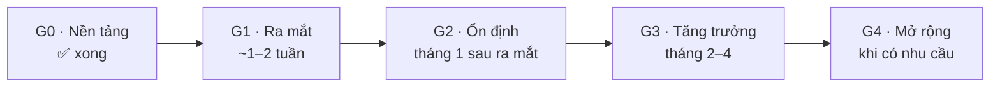

# Lộ trình phát triển

Kế hoạch tổng thể từ hiện tại đến khi website vận hành ổn định và mở rộng. Mỗi giai đoạn có **mục tiêu**, **danh sách việc**, và **điều kiện hoàn thành** — chỉ chuyển giai đoạn khi điều kiện hoàn thành đạt.

Ưu tiên: **P0** chặn ra mắt · **P1** cần trong tháng đầu · **P2** nên có · **P3** khi có nhu cầu.
Thời lượng ước tính cho 1 người làm bán thời gian.

---

## G0 — Nền tảng ✅

Đã hoàn thành. Hệ thống chạy đầy đủ trên máy dev:

- Monorepo `apps/web`, `apps/admin`, `apps/api`, `packages/types`.
- Website khách: xem sản phẩm, giỏ hàng, đặt hàng COD / chuyển khoản, tra cứu đơn, liên hệ, báo giá sỉ, tin tức, chính sách.
- Trang quản trị: tổng quan doanh thu, đơn hàng, liên hệ, sản phẩm nhiều ảnh / nhiều quy cách, nội dung, cài đặt, tài khoản nhân viên.
- API: phân quyền ADMIN/STAFF, rate limit, upload ảnh an toàn, realtime SSE, làm mới cache web tức thì.
- Docker Compose production + Caddy, CI lint + build.

Chi tiết: [features.md](../01-product/features.md).

---

## G1 — Ra mắt (go-live)

**Mục tiêu:** website chạy thật trên tên miền, nhận đơn thật, dữ liệu không thể mất.

| # | Việc | Ưu tiên | Tài liệu |
|---|---|:-:|---|
| 1.1 | **Sửa `.gitignore`**: dòng `**/uploads/` đang bỏ qua cả mã nguồn `apps/api/src/uploads/` → bản clone mới (CI, VPS, Docker) thiếu `UploadsModule` và build API lỗi. Đổi thành `/apps/api/uploads/`, commit lại module | P0 | — |
| 1.2 | Bật branch protection cho `main` (CI bắt buộc xanh) | P0 | [ci-cd.md](../04-operations/ci-cd.md) |
| 1.3 | Mua tên miền, thuê VPS, trỏ DNS 4 bản ghi A | P0 | [deployment.md](../04-operations/deployment.md) |
| 1.4 | Bảo mật VPS: SSH khoá, tắt root, `ufw`, `fail2ban`, swap, giới hạn log Docker | P0 | [deployment.md §2](../04-operations/deployment.md#2-chuẩn-bị-làm-một-lần) |
| 1.5 | Triển khai, tạo ADMIN, chạy checklist sau triển khai | P0 | [deployment.md §4](../04-operations/deployment.md#4-chạy-lần-đầu) |
| 1.6 | Cron sao lưu DB + ảnh, đẩy ra ngoài VPS (rclone → R2/B2/Drive), khôi phục thử 1 lần | P0 | [monitoring-and-backup.md](../04-operations/monitoring-and-backup.md) |
| 1.7 | Giám sát uptime `<DOMAIN>` + `api.<DOMAIN>/health`, báo qua Telegram / email | P0 | [monitoring-and-backup.md §2](../04-operations/monitoring-and-backup.md#2-giám-sát-chưa-có--kế-hoạch) |
| 1.8 | Nhập dữ liệu thật: thông tin cửa hàng, danh mục, sản phẩm (ảnh, quy cách, giá), banner, chính sách đổi trả / vận chuyển / bảo mật | P0 | [admin.md](../03-apps/admin.md) |
| 1.9 | `app/sitemap.ts`, `app/robots.ts` cho web; đăng ký Google Search Console + Google Business Profile | P1 | [web.md](../03-apps/web.md) |
| 1.10 | Header bảo mật cho web / admin trong Caddyfile (HSTS, `X-Frame-Options`, `X-Content-Type-Options`) | P1 | [security.md](../02-architecture/security.md) |
| 1.11 | Chạy thử toàn bộ luồng trên điện thoại thật (Android + iPhone): xem → giỏ → đặt → admin nhận → xác nhận → tra cứu | P0 | [request-flows.md](../02-architecture/request-flows.md) |
| 1.12 | Hướng dẫn chủ shop + nhân viên dùng trang quản trị (1 buổi) | P1 | — |

**Điều kiện hoàn thành:** mọi mục P0 xong; 3 đơn thật đầu tiên được xử lý trọn vòng; đã khôi phục thử bản sao lưu.

---

## G2 — Vận hành ổn định (tháng đầu sau ra mắt)

**Mục tiêu:** không bỏ lỡ đơn, phát hiện lỗi trước khi khách báo, tài khoản chủ shop an toàn.

| # | Việc | Ưu tiên | Ghi chú |
|---|---|:-:|---|
| 2.1 | **Báo đơn mới qua Telegram bot / email** cho chủ shop | P1 | Realtime hiện chỉ hiện khi đang mở admin; ngoài giờ sẽ lỡ đơn. Gọi từ `OrdersService.create()` sau khi lưu đơn, không chặn phản hồi cho khách |
| 2.2 | OTP cho ADMIN | P1 | Thiết kế sẵn ở [admin.md §4](../03-apps/admin.md#4-kế-hoạch-xác-thực-otp-cho-admin) |
| 2.3 | Sentry cho web, admin, API | P1 | |
| 2.4 | Test e2e API cho luồng tiền: báo giá, tạo đơn, chuyển trạng thái, tổng tiền, phân quyền; chạy trong CI với Postgres service | P1 | |
| 2.5 | Lint + type-check `apps/api` trong CI | P1 | |
| 2.6 | Google Analytics 4: đo xem sản phẩm → thêm giỏ → đặt hàng | P2 | |
| 2.7 | JSON-LD: `Product` (giá, còn hàng), `LocalBusiness` (địa chỉ, giờ mở cửa), `Article` | P2 | Hiện rich snippet trên Google |
| 2.8 | Rate limit đăng nhập theo email; Dependabot | P2 | [security.md §4](../02-architecture/security.md#4-còn-thiếu-theo-thứ-tự-ưu-tiên) |
| 2.9 | Tự nén ảnh khi tải lên (sharp → WebP, tối đa 1600 px) | P2 | Giảm dung lượng đĩa và băng thông |

**Điều kiện hoàn thành:** chủ shop nhận thông báo mọi đơn kể cả khi không mở admin; lỗi production được báo trong vòng 5 phút; CI có test luồng đặt hàng.

---

## G3 — Tăng trưởng (tháng 2–4)

**Mục tiêu:** tăng tỷ lệ chốt đơn, giảm việc thủ công của shop.

| # | Việc | Ưu tiên | Ghi chú |
|---|---|:-:|---|
| 3.1 | **Thanh toán VietQR**: hiện mã QR có sẵn số tiền + nội dung = mã đơn ở trang đặt hàng thành công / tra cứu | P2 | Khách chuyển khoản nhanh, shop đối soát dễ. Bước sau: webhook ngân hàng (Casso / SePay) tự đánh dấu "đã thanh toán" |
| 3.2 | Email / Zalo ZNS xác nhận đơn cho khách | P2 | Thêm trường email tuỳ chọn đã có |
| 3.3 | Mã giảm giá (số tiền / %, hạn dùng, số lượt) | P2 | Bảng `coupons`; áp ở báo giá phía API |
| 3.4 | Phí ship theo khu vực (bảng phí nội thành / ngoại thành / tỉnh) để khách thấy trước | P2 | Vẫn cho shop sửa khi xác nhận |
| 3.5 | Xuất đơn hàng ra Excel theo khoảng ngày | P2 | |
| 3.6 | Phân trang + lọc theo giá / quy cách ở `/products` | P3 | Khi > ~60 sản phẩm |
| 3.7 | Tự động triển khai khi merge `main` + gắn tag phiên bản | P2 | [ci-cd.md §3](../04-operations/ci-cd.md#3-cần-bổ-sung) |
| 3.8 | Nhật ký thao tác admin | P3 | |
| 3.9 | Viết 8–10 bài hướng dẫn bảo quản, rã đông, công thức sinh tố | P2 | SEO, việc của chủ shop |

**Điều kiện hoàn thành:** > 50 % đơn chuyển khoản được đối soát tự động hoặc bằng QR; shop không còn tính tay phí ship / giảm giá cho đơn thường.

---

## G4 — Mở rộng (chỉ làm khi có nhu cầu thật)

| Tín hiệu | Việc |
|---|---|
| Ảnh / trang tải chậm với khách ngoài Đà Nẵng, băng thông VPS cao | Cloudflare proxy trước Caddy; chuyển ảnh sang R2/S3 + CDN |
| VPS quá tải (CPU > 70 % thường xuyên) | Nâng cấp VPS trước; chỉ khi không đủ mới tách DB managed và chạy nhiều instance API (cần Redis cho rate limit + SSE) |
| Khách quay lại mua nhiều lần, hỏi lịch sử đơn | Tài khoản khách bằng SĐT + OTP, lịch sử đơn, địa chỉ đã lưu |
| Nhiều khách sỉ cố định | Bảng giá sỉ theo khách, đặt hàng sỉ qua giỏ |
| Mở chi nhánh | Tồn kho theo kho, đơn gắn chi nhánh |

---

## Cách cập nhật tài liệu này

- Xong một việc → đánh dấu trong [features.md](../01-product/features.md) và [production-readiness.md](production-readiness.md), xoá dòng khỏi bảng giai đoạn ở đây (hoặc ghi ✅).
- Thêm việc mới → đặt vào giai đoạn phù hợp kèm ưu tiên; nếu là quyết định kiến trúc, ghi thêm vào [decisions.md](decisions.md).
- Xem lại toàn bộ lộ trình mỗi tháng.
